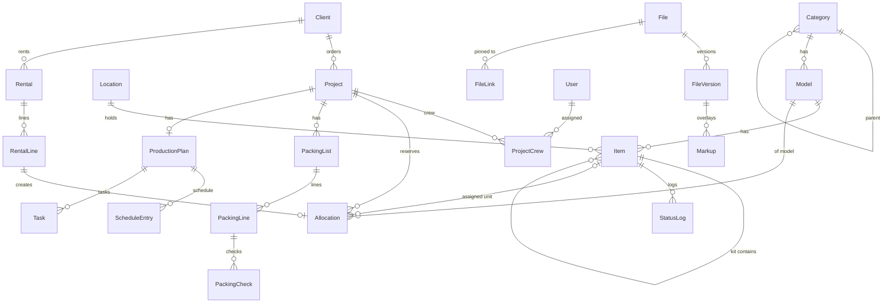

# Vertigo Gear — Plan

Working plan for building the app described in `vertigo-gear-system-prompt.md`.
Read that first; this file is the "how", not the "what". Open questions are at
the bottom — answers there change the data model, so they come before code.

## 1. Guiding ideas

- **One availability engine.** Projects and rentals both create *allocations*
  (model + quantity, or a specific unit) against a date range. Every "is it
  free?", conflict warning, calendar and dashboard number reads the same table.
- **Models carry specs, items carry state.** A model is the catalogue entry;
  an item is the physical thing (serialized) or the bin (bulk). Reservations are
  made at model level; specific units are assigned when packing.
- **Status is driven by flows, editable by hand.** Check-out / check-in /
  rental return set `on project`, `rented out`, `in house`. Admins and members
  can still override with a reason; every change lands in the status log.
- **Modules, not layers.** Each domain lives in `src/modules/<name>/` with the
  same layout. Pages in `src/app/` compose modules; modules never import each
  other's internals, only `index.ts`.
- **Configuration, not constants.** Statuses, project phases, role permissions,
  label sizes, currency and timezone live in `config/app.config.ts` or in the
  database. No magic strings in components.

## 2. Stack (proposed, see questions)

| Concern | Choice | Why |
|---|---|---|
| Framework | Next.js 16 App Router (Turbopack), TypeScript strict | Spec requirement |
| DB / ORM | PostgreSQL 16 + Prisma 7 (driver adapter, multi-file schema, one file per module) | Spec; multi-file keeps modules self-contained |
| UI | Tailwind 4 + shadcn/ui (Base UI primitives), `next-intl` with `messages/en.json` (+ `da.json`) | All strings in one place, Danish-ready |
| Auth | Auth.js v5: Credentials (email+password, bcryptjs) now; Email (magic link) and Google providers are config additions later | "Room for Google login later" without rewriting sessions |
| Validation / API | Zod schemas shared by server actions and REST; OpenAPI generated from Zod, served at `/api/docs` (Scalar UI) | One schema, three uses: forms, API, docs |
| Files | `StorageAdapter` interface: local disk (default) and S3-compatible (R2/MinIO). Resumable upload via tus (`@tus/server` + `tus-js-client`) | Resumable on mobile for 500 MB 3D files; tus has both local and S3 stores |
| Thumbnails | `sharp` for images; PDF first page via `pdftoppm` (poppler) in the Docker image, graceful "no thumbnail" if absent | Pure-JS PDF rasterising is slow and fragile |
| PDF output | `@react-pdf/renderer` for labels, packing lists, day sheets, rental agreements; `pdf-lib` to stamp markups onto uploaded PDFs | No headless browser in the container |
| QR | `qrcode` (server-side SVG/PNG) + `html5-qrcode` for phone scanning | Small, no native deps |
| 3D | three.js + GLTFLoader / OBJLoader / STLLoader, client-only component | Spec requirement |
| Calendar | `ical-generator` for feeds; `googleapis` for push (optional, env-gated) | Spec requirement |
| Jobs | DB outbox table + in-process poller (webhooks, calendar push, thumbnails) | No Redis/queue; one container |
| Tests | Vitest (unit + integration against a test Postgres), Playwright smoke for packing/check-in, GitHub Actions | Spec requirement |
| Deploy | Dockerfile + `docker-compose.yml` (app, postgres, uploads volume); docs for Hetzner VPS and Vercel + managed Postgres | Spec requirement |

## 3. Data model

Entity list grouped by module. `*` = has a `customFields` JSONB column backed
by `CustomFieldDefinition`. All tables have `id` (cuid), `createdAt`,
`updatedAt`; mutations write to `ActivityLog`.

### users
- **User** — email, name, passwordHash, role (`admin` / `member` / `viewer`),
  phone, googleEmail, active.
- **Session / VerificationToken** — Auth.js tables.
- **ApiToken** — user, name, hashed token, scopes, lastUsedAt.
- **ShareLink** — target type + id (packing list / plan), token, expiresAt.

### inventory
- **Category** — name, parentId (tree), sortOrder.
- **Model** `*` — categoryId, manufacturer, name, trackingType
  (`serialized` / `bulk`), specs: weightKg, dimensions, powerDrawW, notes,
  defaultPhotoId, links[].
- **Item** `*` — modelId, serialNumber (serialized only), quantity (bulk only),
  status, locationId, parentItemId (kit membership), isKit, purchaseDate,
  purchasePrice, supplier, insuredValue, replacementValue, conditionNotes,
  tagCode (QR payload).
- **Location** — name, type (`warehouse` / `project` / `renter` / `repair`),
  parentId (zone → shelf), linked projectId / renterId when applicable.
- **StatusLog** — itemId, fromStatus, toStatus, reason, userId, at.
- **Attachment** — polymorphic (entityType, entityId), fileId, kind
  (photo / invoice / manual).
- **CustomFieldDefinition** — entity (model / item / project / rental), key,
  label, type (text / number / date / select / checkbox / url), options[],
  required, sortOrder.

Kits: a kit is an `Item` with `isKit = true`; contents are items whose
`parentItemId` points at it. Bulk contents ("3× XLR") are a bulk `Item` row
with `quantity = 3` inside the kit, drawn from the model's warehouse bin.

### projects
- **Client** — company, contact person(s), email, phone, address.
- **Project** `*` — name, clientId, venueName, venueAddress, status
  (`quote` / `confirmed` / `in_progress` / `done` / `cancelled`), dates:
  prepStart, loadIn, showStart, showEnd, loadOut, returnDate; notes,
  externalLinks (Drive / Notion), googleEventIds JSON.
- **ProjectContact** — projectId, name, role, phone, email.
- **ProjectCrew** — projectId, userId, role, callTime.
- **Allocation** — holderType (`project` / `rental`), holderId, modelId,
  quantity, itemId (nullable, set when a unit is assigned), startDate,
  endDate, note. *This is the availability table.*

### rentals
- **Rental** `*` — clientId (reuses `Client`), status
  (`reserved` / `out` / `returned` / `overdue`), startDate, endDate,
  deposit, notes, googleEventIds.
- **RentalLine** — rentalId, modelId, quantity, pricePerDay, pricePerWeek,
  itemId when assigned. Creates matching `Allocation` rows.

### packing
- **PackingList** — projectId, name, groupBy (`category` / `case`),
  checkedOutAt, checkedInAt.
- **PackingLine** — listId, modelId, quantity, itemId (assigned unit),
  caseItemId (which case it travels in), sortOrder.
- **PackingCheck** — lineId, itemId, phase (`out` / `in`), checkedBy,
  checkedAt, outcome (`ok` / `missing` / `damaged`), note.
- **PackingTemplate / PackingTemplateLine** — same shape, no project.

### plans
- **ProductionPlan** — projectId, templateId.
- **ScheduleEntry** — planId, day, startTime, durationMin, title, location,
  responsibleUserId, notes, phase.
- **Task** — planId, title, phase (`pre` / `build` / `show` / `post`),
  assigneeId, dueDate, done.
- **LogisticsEntry** — planId, type (vehicle / parking / dock / hotel /
  travel), details, notes.
- **PlanTemplate** — name, schedule and task skeleton as JSON.
- Crew and contacts come from `ProjectCrew` / `ProjectContact`.

### files
- **File** — name, mimeType, size, storageKey, uploaderId, previewImageId,
  currentVersionId.
- **FileVersion** — fileId, versionNo, storageKey, size, uploaderId.
- **FileLink** — fileId, entityType, entityId (plan / schedule entry / task /
  item / project); enables "pin to schedule entry".
- **Markup** — fileVersionId, pageNo, userId, shapes JSON (freehand, arrow,
  rect, text).

### calendar / integrations
- **CalendarFeedToken** — userId (nullable for team-wide feeds), scope
  (`projects` / `rentals` / `mine`), token.
- **Webhook** — url, secret, events[], active.
- **Outbox** — type, payload, attempts, nextRunAt, lastError.
- **ActivityLog** — userId, entityType, entityId, action, diff JSON.

### Core relations



### Availability rule (the one that must be right)

For a model `M` in window `[a, b)`:

```
owned(M)      = items of M with status not in {retired}
unavailable   = items of M with status in {in repair, missing}
                (treated as unavailable for the whole window)
allocated(M)  = sum(quantity) of Allocation rows for M whose [start, end)
                overlaps [a, b), excluding the allocation being edited
available(M)  = owned(M) - unavailable - allocated(M)
```

A serialized unit is double-booked if two overlapping allocations name the
same `itemId`. The conflict warning lists the clashing project/rental, dates
and quantity so the user can decide. Tested in isolation with fixed fixtures.

## 4. Repository layout

```
config/app.config.ts        statuses, phases, roles, labels, currency, tz
prisma/schema/*.prisma      one file per module
prisma/seed/                re-runnable demo data (also used by tests)
src/app/                    routes only; thin, calls modules
src/modules/<domain>/
  index.ts                  public interface (the only import allowed)
  schema.ts                 zod schemas (forms + API + OpenAPI)
  service.ts                business logic, takes a db + actor
  actions.ts                server actions (auth + call service)
  queries.ts                read models for pages
  components/               UI for this domain
  __tests__/
src/lib/                    db, auth, storage adapter, i18n, pdf, qr, outbox
src/api/                    REST route handlers + OpenAPI registry
messages/en.json, da.json
docs/ARCHITECTURE.md, DECISIONS.md, BACKLOG.md, CLAUDE.md (root)
```

## 5. Phases

Each phase ends with: migrations applied, seed updated, tests green in CI,
`CLAUDE.md` updated, a commit, and a short "what to click" note.

### Phase 0 — Skeleton ✅ (2026-10-11)
Repo, Next.js, Prisma + Postgres via compose, Auth.js, shadcn, next-intl,
config file, module scaffold, Vitest + Playwright + GitHub Actions, Dockerfile,
`CLAUDE.md` / `DECISIONS.md` / `BACKLOG.md` / `ARCHITECTURE.md` stubs.

### Phase 1 — Inventory core ✅ (2026-10-11)
Users + roles + login, categories (tree editor), models, items (serialized +
bulk), kits, locations, status log with reason, attachments (photos, invoices,
manuals through the storage adapter), QR tag generation and item page by
scan, search/browse with filters, dashboard "what we have / what's out / in
repair / missing", activity log, custom field definitions + values, REST
`/api/v1/{categories,models,items,locations}` with OpenAPI docs.
**Tests:** permissions matrix, status transitions, custom field validation.

### Phase 2 — Projects, availability, rentals, calendar ✅ (2026-10-12)
Clients, projects with phases and crew, allocations, availability engine and
conflict warnings, per-model availability view, timeline/calendar view,
rentals with lines and totals, rental agreement PDF, iCal feeds, optional
Google Calendar push via outbox, webhooks (first events).
**Tests:** availability maths, overlap edge cases, rental vs project
conflicts, idempotent calendar push (mocked API).

### Phase 3 — Packing ✅ (2026-10-12)
Packing lists from catalog / kits / templates / previous project, grouping by
category or case, weight / case / power totals, packing mode with QR scan
and check-out, check-in with missing/damaged flags, PDF export, share links.
**Tests:** check-out / check-in state machine, partial returns, kit
expansion, share link access without login.

### Spec update (2026-10-12) ✅ schema part
`SPEC.md` replaced the original system prompt and `MIGRATION.md` describes
the spreadsheet we migrate from. Done now: `under_construction` status,
retired reason (sold / scrapped / lost), not-for-rental flag on models and
items, person locations (user or contact), contacts, category-scoped custom
fields with the seeded field sets. Deferred to after Phase 4 (see
`BACKLOG.md`): pricing engine and rate tables, quote PDF, sub-hire catalog,
wish list, purchase records. The spreadsheet importer is Phase 5a.

### Phase 4 — Production plans ✅ (2026-10-12)
One plan per project: day-by-day schedule (time, duration, place, who),
tasks by phase with assignee, due date and done state, crew & contacts from
the project, logistics (vehicles, parking, dock, hotel, travel), plan
templates relative to the load-in day (apply / save as), day sheet and full
plan PDF, read-only share link.
**Tests:** template date maths and round trip, day grouping, task order and
progress, plan lifecycle (DB), PDF smoke, browser flow.

### Phase 4b — Documents, drawings, 3D, markup ✅ (2026-10-12)
Documents on a plan with versions (same name = new version), chunked
resumable upload, inline viewers for images, PDFs (page navigation) and
glTF/GLB/OBJ/STL (orbit, grid, lights, two-point measure), native formats
stored with an optional preview image, markup layer (pen, arrow, box, text)
saved separately with authorship, documents pinned to schedule entries and
tasks, markups drawn into the plan and day-sheet PDFs, documents on the
share page.
**Tests:** chunk assembly, file versioning, markup authorship, PDF export
with markup, browser upload/version/markup flow.

### Phase 5a — Spreadsheet importer ✅ (2026-10-12)
Settings › Import: upload `Vertigo Gearliste _ Status.xlsx` (kept out of
git), read every sheet (cables / LED / boxes, QLED recount, controllers by
ID, projectors, computers, truss, stands, rods, loans, key fobs, rate
tables), and show a plan in four buckets: will import, imported with an
assumption (the guess is shown), needs a decision (a select per row), and
parked (pricing, wish list, sub-hire, purchase records: shown, never
written). Nothing is written until the plan is confirmed. Models, bulk
bins and serialized units with the sheet's own IDs as asset tags, kits
for flightcases, contacts and person locations for lent gear, open loans
as rentals. Every row remembers its cell (`importSource`), the activity
row lists every id created, and re-importing the same file writes
nothing. Models carry `rentalDayPrice` from the sheet for the pricing
engine later.
**Tests:** parse helpers and readers on a synthetic workbook, plan
buckets and decisions, commit against the database (idempotent re-run,
add-to-existing), browser upload → preview → decide → import.

### Phase 6 — Pricing engine, rate tables, quote PDF ✅ (2026-10-12)
Every model has a rental day price (imported from the sheet, editable on
the model). Settings › Pricing holds named rate tables (days → factor,
step function to the nearest lower tier, and a rule beyond the last tier:
+factor per further day or per started 10 days); Standard, Theatre and
Revised come from the `lejefaktor` sheet via seed or importer. A project
or rental picks a table (the default unless chosen), can override the
charge days and set a document discount and terms. Gear lines are the
reservations (projects) or rental lines, with a day-price snapshot and a
line discount; extra lines (freight, insurance, crew) are fixed amounts.
Totals excl. and incl. 25% VAT; quote PDF for projects, rental agreement
PDF for rentals (same renderer, signature boxes on the agreement).
**Tests:** engine (tiers, rules, discounts, rounding) against the real
tables, rate table CRUD + rental and project quotes (DB), browser: rate
table editor with live factor preview, project quote with discount, extra
line and PDF.

### Phase 5b — Deployment, export, labels, polish (in progress)
Deployment ✅ (2026-10-13): Caddy with automatic HTTPS in the Compose
stack, health endpoint and container healthcheck, login rate limit,
nightly backup script with off-site copy and a tested restore script,
GitHub Actions deploy after CI, README with Compose, Hetzner and Vercel
step by step.
Labels ✅ (2026-10-13): Avery sheets with an offset for used cells and
single thermal labels, from the item list, a model or a unit
(`/api/labels/sheet.pdf`); pure grid maths in `label-layout.ts`.
Export and backup ✅ (2026-10-13): CSV of every list with its filters
(`/api/export/<list>.csv`), Settings › Backup with a whole-database JSON
download and a one-transaction restore.
Still to do: empty states and inline help, README polish.
**Tests:** rate limiter, health route, label layout, CSV, backup tables
and round-trip (CI).

## 6. Decisions I will make unless you object

These go into `DECISIONS.md` with reasoning.

- Single studio, no multi-tenancy.
- Dates stored UTC, displayed Europe/Copenhagen, 24 h, `dd.mm.yyyy`.
- Reservations are model-level; units are assigned in packing mode.
- `in repair` and `missing` items are unavailable for allocation.
- A kit is reserved and packed as one unit; its contents are not separately
  allocatable while they are in the kit.
- Rental prices per line, totals ex. VAT, VAT rate in config.
- Server actions for form mutations, REST for client-side fetches (search,
  scan lookup) and for external tools. Both call the same module service.
- Auth.js with JWT sessions (the Credentials provider requires it).

## 7. Questions before code

These are the decisions that would be expensive to reverse.

1. **Postgres only?** Supporting SQLite for dev doubles the migration
   testing and blocks JSONB custom fields. I recommend Postgres everywhere,
   started with `docker compose up db`. OK?
2. **Primary hosting target: Docker on a VPS, or Vercel?** It decides
   whether I may rely on native tools in the container (poppler for PDF
   thumbnails, tus with a local disk). Vercel-first means pure-JS only and
   S3 storage mandatory. I recommend Docker/VPS first, Vercel documented as
   "works with S3 + external Postgres, no PDF thumbnails".
3. **Who may see purchase prices and insured values?** Everyone logged in,
   or admins only? Affects the permission model and the exports.
4. **Email sending.** Magic links and password resets need SMTP. Do you have
   a provider (Google Workspace SMTP, Postmark, Resend)? If not, I ship
   password login only and leave magic link behind an env flag.
5. **Bulk items in kits.** Should "Laser case 1 contains 3× 5 m XLR" pull
   those 3 cables out of the general XLR count permanently (until the kit is
   dissolved), or should the kit only *remind* you to add 3 cables when
   packing? I recommend the first (true contents), since that is what is
   physically in the case.
6. **Can you share the existing inventory spreadsheet now?** Even a partial
   export shapes the model/item fields and the importer. Not blocking Phase 1.
7. **Rental and project in one job?** Occasionally you may sub-hire gear
   *in* from another company for a project. Out of scope for now, or should
   the data model leave a hook (an "external" item flag)? I would put it in
   the backlog and add nothing now.
