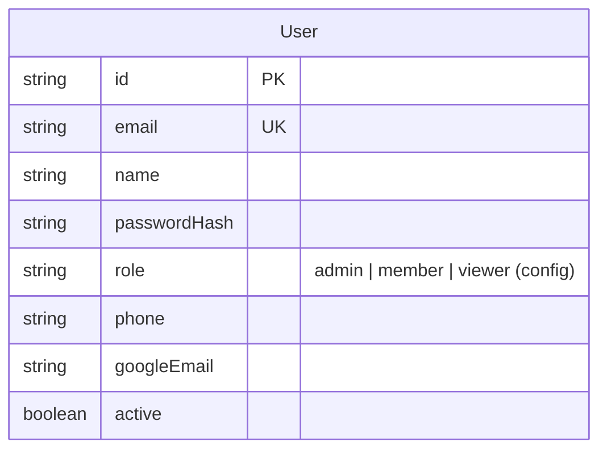

# Architecture

## Shape

```
Browser (phone / laptop)
   │  HTML + server actions            │  JSON (/api/v1, OpenAPI at /api/docs)
   ▼                                   ▼
Next.js 16 app (one Node process) ──── module services ──── Prisma 7 ──── PostgreSQL 16
   │                                   │
   │  StorageAdapter (local disk | S3) │  Outbox poller (webhooks, calendar push, thumbnails)
   ▼                                   ▼
uploads volume / R2 / MinIO         Google Calendar API (optional)
```

- One container, one database, one uploads volume. No queue, no cache
  server. Background work goes through an `Outbox` table polled in-process.
- The UI calls module services through server actions. External tools call
  the same services through REST with per-user API tokens.

## Modules

| Module | Owns | Public interface (planned) |
|---|---|---|
| users | User, ApiToken, ShareLink | `users.*`, `can()` |
| inventory | Category, Model, Item, Location, StatusLog, Attachment, CustomFieldDefinition | `inventory.*` |
| projects | Client, Project, ProjectContact, ProjectCrew, Allocation | `projects.*`, `availability.*` |
| rentals | Rental, RentalLine | `rentals.*` |
| packing | PackingList, PackingLine, PackingCheck, PackingTemplate | `packing.*` |
| plans | ProductionPlan, ScheduleEntry, Task, LogisticsEntry, PlanTemplate | `plans.*` |
| files | File, FileVersion, FileLink, Markup | `files.*`, storage adapter |
| calendar | CalendarFeedToken, Google sync | `calendar.*` |

Cross-cutting: `ActivityLog`, `Outbox`, `Webhook` live in `src/lib/`.

## Data model (current)

Phase 0 contains only `User`. The full target model is in `PLAN.md` §3;
this diagram grows with each phase.



## Request lifecycle

1. `src/proxy.ts` decodes the session cookie; anonymous → `/login`.
2. Layout `(app)/layout.tsx` calls `requireActor()`.
3. Page reads data through a module's `queries.ts`.
4. A form posts to a server action in the module's `actions.ts`, which calls
   `requirePermission(...)`, then `service.ts`, then `revalidatePath`.
5. Services write `ActivityLog` rows and enqueue `Outbox` events for
   webhooks and calendar sync (from Phase 1/2).

## Configuration

`config/app.config.ts` is the single place for statuses, phases, roles,
permissions, label sizes, currency, timezone and locale. Environment
variables (`.env.example`) hold secrets and deployment-specific values.
