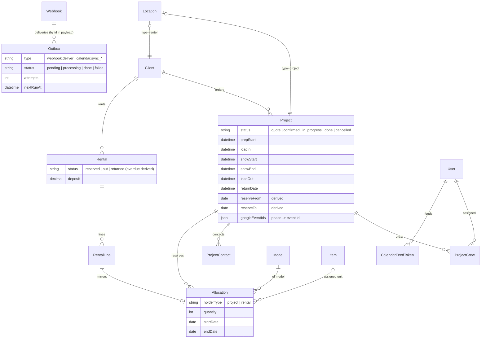
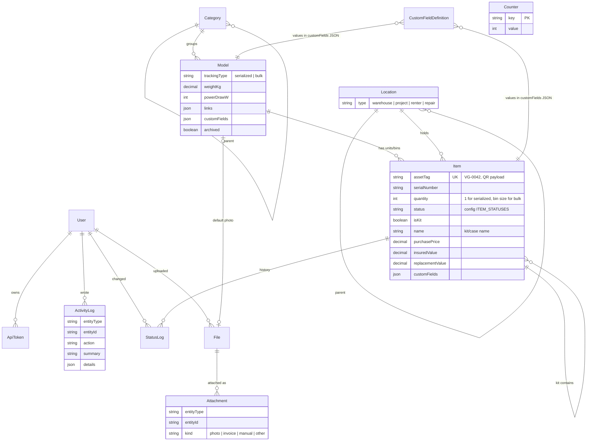

# Architecture

## Shape

```
Browser (phone / laptop)
   │  HTML + server actions            │  JSON (/api/v1, OpenAPI at /api/docs)
   ▼                                   ▼
Next.js 16 app (one Node process) ──── module services ──── Prisma 7 ──── PostgreSQL 16
   │                                   │
   │  StorageAdapter (local disk | S3) │  Outbox poller (webhooks, calendar push) — Phase 2
   ▼                                   ▼
uploads volume / R2 / MinIO         Google Calendar API (optional)
```

- One container, one database, one uploads volume. No queue, no cache
  server. Background work will go through an `Outbox` table polled
  in-process (Phase 2).
- The UI calls module services through server actions. External tools call
  the same services through REST with per-user API tokens.

## Modules

| Module | Owns | Public interface |
|---|---|---|
| users | User, ApiToken | `users.*`, `apiTokens.*`, user/account actions |
| settings | CustomFieldDefinition | `customFieldDefinitions.*` |
| inventory | Category, Model, Item, Location, StatusLog | `categories`, `locations`, `models`, `items`, list/detail queries, forms |
| files | File, Attachment | `files.*`, `AttachmentsSection` |
| projects | Client, Project, ProjectContact, ProjectCrew, Allocation | `clients`, `projects`, `allocations`, availability engine, timeline |
| rentals | Rental, RentalLine | `rentals`, `rentalLines`, pricing, agreement PDF |
| packing | PackingList, PackingLine, PackingCheck, PackingTemplate (Phase 3) | |
| plans | ProductionPlan, ScheduleEntry, Task, LogisticsEntry, PlanTemplate (Phase 4) | |
| calendar | CalendarFeedToken, Google sync, outbox handlers | `feedTokens`, `buildFeed`, `syncProject`, `syncRental` |
| settings | CustomFieldDefinition, Webhook, Outbox admin | `customFieldDefinitions`, `webhooks`, `outboxAdmin` |

Cross-cutting in `src/lib/`: `activity.ts` (ActivityLog), `asset-tag.ts`
(Counter-backed tag sequence), `custom-fields.ts` (pure validation),
`forms.ts` (FormData → zod → FormState), `storage/` (adapter),
`api/` (REST auth, error mapping, OpenAPI), `auth/` (Auth.js, permissions).

## Data model (Phase 2 additions)



## Data model (Phase 1)



Rules encoded in services (not the database):

- A **kit** is a serialized item with `isKit`. Contents have `parentItemId`.
  Status changes and moves cascade to contents; a kit cannot contain itself.
- **Bulk bins**: one `Item` row per bin; the kit seed moves 3 cables from
  the wall bin into a kit bin.
- **Status changes** go through `items.changeStatus`, which validates with
  `validateStatusChange` (reason required for repair/missing/retired) and
  writes `StatusLog` + `ActivityLog`.
- **Finance fields** are stripped by `redactFinance` for actors without
  `inventory.finance`.
- **Custom fields** are validated against `CustomFieldDefinition` rows with
  a zod schema built at request time; values live in `customFields` JSONB.

## Request lifecycle

1. `src/proxy.ts` decodes the session cookie; anonymous → `/login`.
   `/api/*` is skipped: API handlers authenticate (Bearer or session) and
   answer 401.
2. Layout `(app)/layout.tsx` calls `requireActor()`.
3. Page reads data through a module's `queries.ts`.
4. A form posts to a server action in the module's `actions.ts`, which calls
   `requirePermission(...)`, parses with zod (`parseForm`), calls
   `service.ts`, then `revalidatePath`.
5. Services call `assertCan`, write `ActivityLog` rows, and (Phase 2)
   enqueue `Outbox` events.

## Configuration

`config/app.config.ts` is the single place for statuses (with
`available`, `reasonRequired`, `manual` flags), phases, roles,
permissions, label sizes, asset tag prefix, currency, timezone and locale.
Environment variables (`.env.example`) hold secrets and deployment values.
